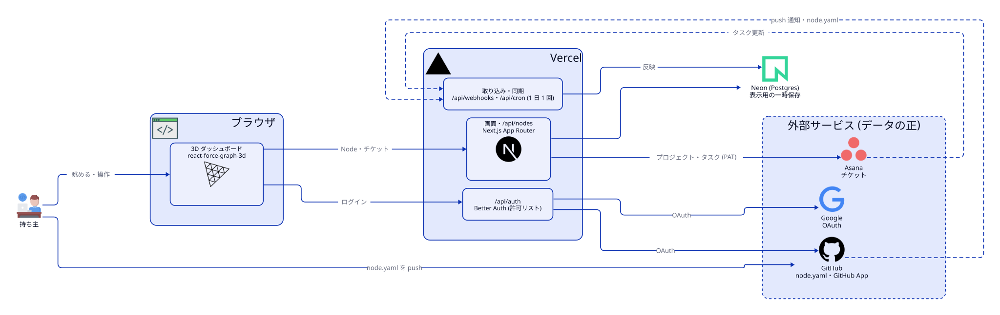

# management-self-pieces

自分の成果物 (アプリ・スキル・文書など) を「Node」として扱い、3D 空間に浮かぶグラフで眺め、Asana のプロジェクトでチケット管理するための個人用 Web アプリ。Node の内容は各リポジトリのルートに置く `node.yaml` が正で、アプリの DB は表示用の一時保存。消えても GitHub と Asana から作り直せる。

## 構成

<picture>
  <source media="(prefers-color-scheme: dark)" srcset="docs/architecture/architecture-dark.svg">
  
</picture>

図のソースは [docs/architecture/architecture.d2](docs/architecture/architecture.d2)。構成を変えたら `.d2` を直し、`arch-diagram` スキルの `render.py` で SVG を描き直す。

## 主な機能

- 3D ダッシュボード: Node を関係付きのグラフで表示する
- 詳細パネル: detail の Markdown、図の一覧、チケットを表示する
- Asana 連携: Node と Asana プロジェクトを 1 対 1 で対応づけ、更新は Webhook で受け取る
- GitHub からの自動取り込み: GitHub App の push Webhook で、リポジトリの node.yaml を読み直す
- MCP の口: Claude Code から Node と看板を読む (`/api/mcp`)。エージェント用トークンと IP 許可リストで守る
- devloop: AI のチームが Node の開発を少しずつ進める。看板は Asana、制御と記録はアプリ

## ローカルでの起動

```bash
pnpm install
# .env.example を .env.local にコピーし、値を入れる
pnpm db:migrate
pnpm db:seed
pnpm dev
```

`http://localhost:3000` を開く。

## スクリプト

| スクリプト | 内容 |
|---|---|
| `pnpm dev` | 開発サーバーを起動する |
| `pnpm dev:local` | 127.0.0.1 だけで待ち受けて開発サーバーを起動する (ローカル機能を使うとき) |
| `pnpm build` | 本番用にビルドする |
| `pnpm start` | ビルド済みの本番サーバーを起動する |
| `pnpm lint` | ESLint を実行する |
| `pnpm typecheck` | `next typegen` の後に `tsc --noEmit` を実行する |
| `pnpm test:unit` | Vitest を 1 回実行する |
| `pnpm db:generate` | Drizzle のマイグレーションファイルを生成する |
| `pnpm db:migrate` | マイグレーションを `DATABASE_URL` の DB に適用する |
| `pnpm db:seed` | `fixtures/` の node.yaml を DB に入れる (`scripts/seed.mts`) |

## 関連文書

- [docs/SETUP.md](docs/SETUP.md): 外部サービスの設定、環境変数、Vercel へのデプロイ
- [docs/DESIGN.md](docs/DESIGN.md): 設計メモ (データの正、技術構成、拡張の口)
- [docs/TODO.md](docs/TODO.md): 残タスク
